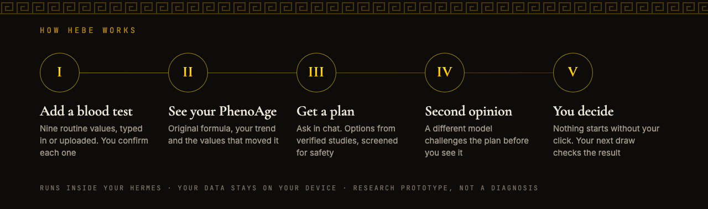
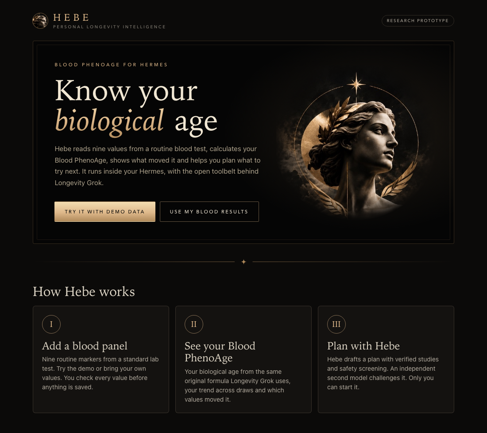
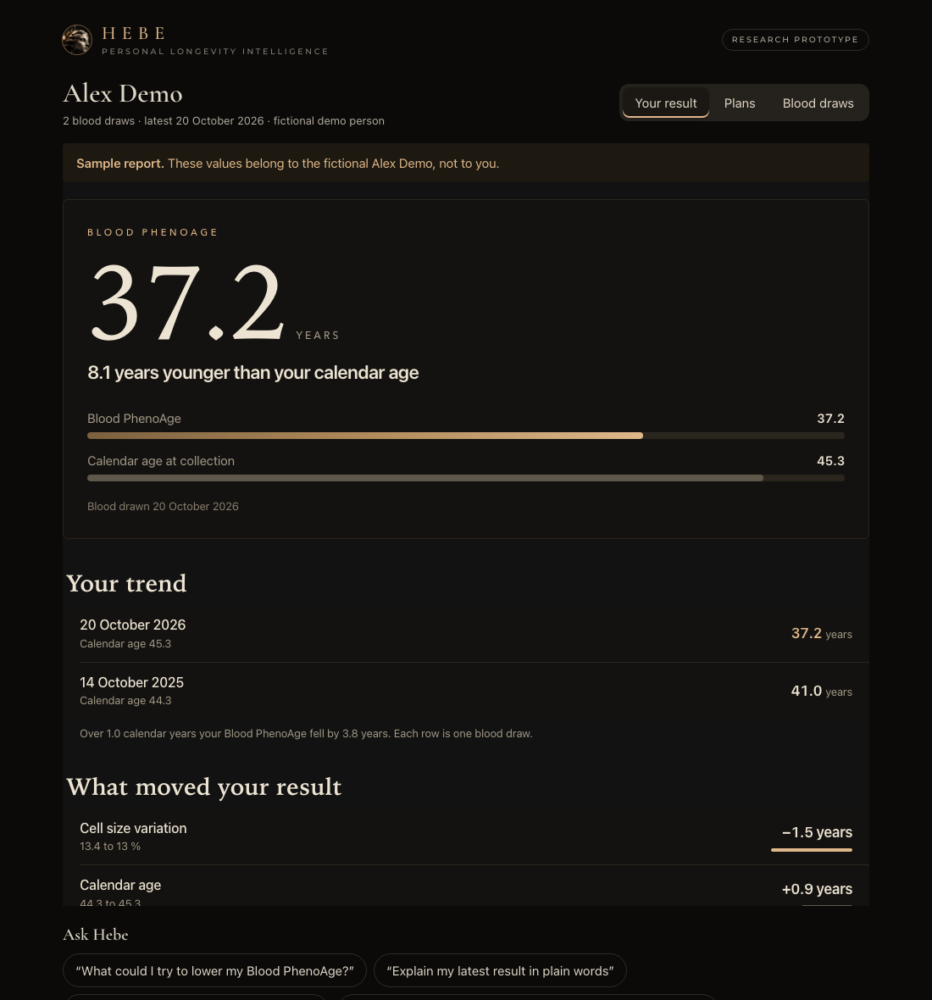
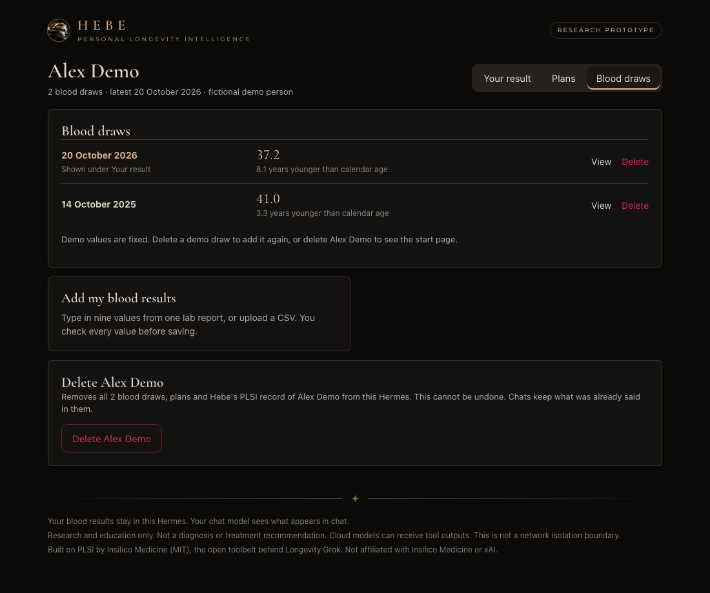
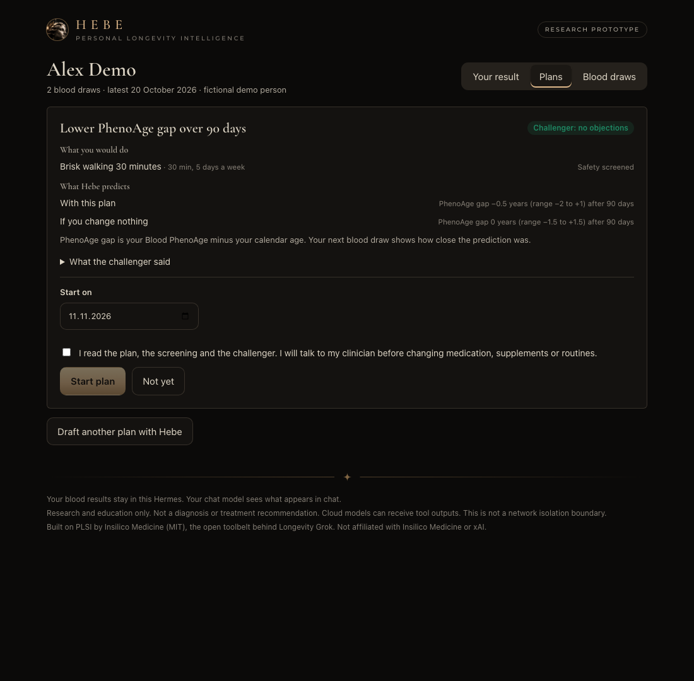

# Hebe Longevity

**Personal Longevity Intelligence for Hermes**

Know your biological age. Hebe reads nine values from a routine blood test, calculates your Blood PhenoAge, shows what moved it and helps you plan what to try next, with the open toolbelt behind Longevity Grok running inside your Hermes.

Published by [BrainArts Lab](https://github.com/brainarts-lab) · [@chrisbrainarts on X](https://x.com/chrisbrainarts) · MIT licensed

### What you get

- **A Hebe page in Hermes Desktop.** Open **Hebe** in the sidebar: add a blood test, check every value, see your report, start plans. All with clicks, no files or commands needed
- **Your Blood PhenoAge** from nine routine blood markers, calculated with the same original formula Longevity Grok uses
- **Your trend** across blood draws and which values moved your result
- **Your draws, under your control.** View any earlier draw, correct a typo or delete a draw. Deleting a person removes their draws, plans and PLSI record. Every change needs your click on the Hebe page
- **A research plan**, built the Longevity Grok way: verified studies, safety screening, an independent challenger model, and a start that only you can approve
- **A Hebe theme for Hermes.** Black marble and champagne gold for the whole app, offered on the Hebe page and in Settings > Appearance. It is never switched on for you, and the Hebe page offers the way back
- **One install.** Longevity Grok creates a team of bots; in Hermes the same roles run as skills in your agent, and your data stays in your Hermes home



| Start in Hermes Desktop | Your Blood PhenoAge and trend |
| --- | --- |
|  |  |

| Blood draws under your control | Screened plans with a second opinion |
| --- | --- |
|  |  |

### What you do

1. Open **Hebe** in the sidebar and select **Try it with demo data**, or type in the nine values from your own lab report
2. Ask Hebe in chat: "What could I try to lower my Blood PhenoAge?"
3. Start the plan on the **Plans** tab

No Desktop? The same works with `/hebe` in any Hermes chat; `/hebe help` shows everything.

Longevity Grok's open PLSI toolbelt, pinned and unchanged, running inside Hermes. Confirm a blood panel, get a traceable blood PhenoAge, your trend and what moved it, then draft a screened plan that an independent challenger checks and only you can start.

**Research prototype. Not a diagnosis or treatment recommendation.** No clinical validation is claimed. Built on PLSI by Insilico Medicine (MIT). Not affiliated with or endorsed by Insilico Medicine or xAI.

## Try it

Requires Hermes >=0.23.0 (tested commit recorded in the project status). Needs PLSI's two Python packages (`pydantic`, `PyYAML`), which Hermes installs after asking. The PhenoAge demo needs no model or API key; plans use your configured Hermes model.

```sh
hermes plugins install https://github.com/brainarts-lab/hebe-longevity --enable
```

Enable `hebe-longevity` if your installer does not enable it, then start a new Hermes chat. To install a local clone, pass it as a Git URL, for example `hermes plugins install file:///absolute/path/to/hebe-longevity`.

Hermes asks two questions during install. **Python dependencies:** `pydantic` and `PyYAML`, PLSI's only requirements. **Security scan caution:** the scanner flags patterns in unchanged PLSI files, for example a variable named `env` in its formula engine and `pip install` hints in error messages. Review the list and continue if you trust the source. Headless installs answer with `--yes-deps --force`.

Enter **`/hebe`**. Review the fictional Alex Demo panel and select **Save and calculate**. Hebe returns blood PhenoAge and a local report link. Enter `/hebe` a second time to add an earlier fictional draw in typical lab units (mg/dL, g/dL, 10\*9/L); the report then shows your trend and what moved your result. This requires a Hermes surface supporting plugin confirmation dialogs; if no dialog is available, nothing is committed. Report links point to the machine running Hermes; remote messenger clients may not open them.

## Your own CSV (advanced, research use only)

Copy `data/demo.csv` as the template. Replace fictional data with your local pseudonym and values, preserving exact header order. Enter:

```text
/hebe import "/absolute/path/panel.csv" 1981 person-id
```

All nine markers, one matching person, one draw/date, unique observation IDs and `status=final` are required. Units follow PLSI exactly (`hebe/plsi_units.py`, the unchanged `map/units.py`): the canonical unit, a conversion sourced in the pinned PLSI map (creatinine and glucose from mg/dL, Young 1987), or PLSI's generic UCUM prefix/volume scale within the same kind of quantity (for example albumin g/dL, CRP mg/L, WBC 10\*9/L). Conversions between kinds of quantity (mass to molar) or unknown spellings are refused; no guessed conversions. Every conversion is shown before you confirm. The original value and unit stay in the confirmed snapshot. Files are limited to 64 KiB. Negative values, nonfinite values, percentages outside 0–100, CRP <=0, future dates and minors are refused. Only unsigned plain decimal notation is accepted (for example `44` or `4.4`, without spaces or exponents). With birth year alone, the collection year must be at least birth year + 19 to establish adulthood conservatively. These checks are not a complete medical plausibility assessment. Birth year is approximated to mid-year by the upstream age formula.

`/hebe status` lists saved results. Several draws of the same person form a trend in the report; the headline always shows the latest draw. **What moved your result** recalculates the original PhenoAge formula with one value from the newer draw and the rest from the previous draw, the same method as PLSI's `plsi calc derive --set`. A remainder from values interacting in the formula is shown so the rows add up to the real change. This describes the formula's response, not a cause or a recommendation. No outside benchmarks or reference ranges are used. `/hebe report RESULT_ID` regenerates the report. A repeated confirmation is idempotent. Corrections and deletion are available through the Blood draws tab with a fresh confirmation.

## Data and approval

Data lives under the active `HERMES_HOME/plugin-data/hebe-longevity/`, never the plugin installation directory. Validated previews are stored locally for up to 30 minutes (expired previews are removed on the next preview), separately from confirmed results. Starting the same preview refreshes its 30-minute deadline; cancelling or a missing confirmation dialog discards it. The dialog approves an immutable snapshot, not a later file read. The database uses transactions to prevent duplicate concurrent commits.

**Corrections and deletion.** Under **Blood draws** on the Hebe page you can correct a saved draw (you review the new values and confirm, like a new draw), delete one draw or delete a person. Each needs a fresh confirmation that only the page requests after your click; the agent has no tool for it. Hebe hands PLSI the current draws as one document with PLSI's own `plsi revise`, so corrected and deleted values are retracted in PLSI's append-only log, never edited. Deleting a person also removes their plan drafts, started plans and PLSI record. Demo draws cannot be corrected, only deleted.

The model tool `hebe_preview` can prepare **fictional** demo data and list result identifiers. It cannot approve or commit. Real imports use the user command and confirmation dialog. Who may answer a dialog in a shared messenger session depends on Hermes and has not been tested. This permission split is not a sandbox against a separately enabled shell or other powerful tools.

PhenoAge, trend and reports make no network or model calls. The Hebe page in Desktop loads its display fonts (Cormorant Garamond, Montserrat) from Google Fonts, like several built-in Hermes themes do; that request carries no health data, and the page falls back to system fonts when it is offline. Plans do: evidence search contacts the public sources listed under Plans with topic queries only, and the challenger is a call to your configured model. **Hermes itself may send chat/tool outputs to your configured cloud model.** The plugin does not enforce network isolation. Health data shown in reports and chat remains sensitive. Delete draws or people on the Hebe page, or the plugin data directory to remove everything; there is no automatic retention policy for confirmed results.

## Plans (Longevity Grok on Hermes)

Ask Hebe in chat, for example "What could I try to lower my Blood PhenoAge?". The agent loads `hebe-longevity:plan`, which follows PLSI's original Nostradamus planning skill (bundled unchanged as `hebe-longevity:nostradamus-plan`) with Hermes tools instead of a shell:

| PLSI step | In Hebe |
|---|---|
| State, calculators, evidence | `hebe_state`, `hebe_calc`, `hebe_evidence` run the original `plsi` commands |
| Screening and plan gates | `hebe_plan_check`: Hebe gate, then original `plsi screen` and `plsi plan check` |
| PLSI Challenger | `hebe_challenge`: a separate Hermes model call (auxiliary task `hebe_challenger`, its own model if you configure one) that sees only the plan, state and screening, never the planner's reasoning |
| Record and adopt | only the user: `/hebe plan start PLAN_ID [YYYY-MM-DD]` shows the plan, cautions and objections in a confirmation dialog |

**Give the challenger a strong model.** Hermes runs auxiliary tasks on a light model by default (`auto`). For an independent check, pick a strong model that differs from your chat model, from any provider you are signed in to. For example, with a ChatGPT subscription and `gpt-6.1-sol` as the chat model:

```sh
hermes config set auxiliary.hebe_challenger.provider openai-codex
hermes config set auxiliary.hebe_challenger.model gpt-6-astra
hermes config set auxiliary.hebe_challenger.reasoning_effort high
```

If the configured provider fails (no credit, no access), Hermes falls back to another model, possibly your chat model. Check `agent.log` for `Auxiliary hebe_challenger` when independence matters.

Hermes may warn that the key is not recognized; plugin tasks are registered at runtime and the setting is read.

`/hebe plan` lists recorded plans and drafts. A draft must be challenged before it can start. Cautions from screening are accepted by starting; a block cannot start.

**Hebe gate.** PLSI screens drugs and supplements by label only when the action's category is `drug` or `supplement`. We reproduced that an RxNorm-coded action filed under `other` passes PLSI screening and plan check without any label check. Hebe refuses such a plan before PLSI sees it.

The toolbelt runs as a child process of Hermes' own Python with an allowlist of commands, argument lists only (no shell), and its data under the plugin data directory. Evidence search and verification contact PubMed, Europe PMC, ClinicalTrials.gov, openFDA or Evipedia with topic queries only. PLSI's Mothership sharing, feedback, oracles, research autopilot and other commands are not reachable.

## Supported now

Hebe page and theme in Hermes Desktop, chat result card, strict CSV and typed entry review, PLSI unit handling, two fictional demo draws, user confirmation, correcting and deleting draws and people, blood PhenoAge, trend across draws, formula drivers between draws, HTML report, PLSI evidence search and verification, PLSI screening and plan gates, independent challenger, user-only plan start, PLSI plan list and due predictions.

**Unsupported:** FHIR, PDF/photo extraction, wearables, maps other than blood PhenoAge, care context (medications, conditions) for screening, PLSI specialists beyond Nostradamus and Challenger, plan review and scoring commands, Mothership sharing, the standalone web dashboard tab (Hebe's page is in Hermes Desktop) and an offline security boundary. Rejecting FHIR does not repair the upstream FHIR importer.

A subset of PLSI at commit `17c433c4a9ecb54279ab02ba1d7d63ee8e8a2e81` is bundled byte-for-byte under `vendor/plsi` (hashes in `vendor/plsi.manifest.json`; one unused file left out and listed there). No automatic updates. See `NOTICE.md`.

## Development

```sh
python3 -m unittest discover -s tests -v
hermes plugins validate . --install-deps --json
hermes plugins doctor . --ci
```

Hebe's own code uses the standard library; the bundled PLSI toolbelt needs pydantic and PyYAML, and the API route tests use FastAPI and httpx. Verified in Hermes Desktop and headless Chrome; shared messenger dialog permissions depend on Hermes and have not been tested.

Artwork: the Hebe bust in the banner, logo and Desktop page was generated with Canva from the Hebe moodboard.
